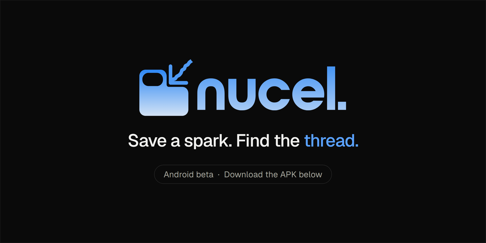

<p align="center">
  
</p>

# Nucel for Android

Nucel is a personal knowledge base: save things from anywhere, and find and ask about them later.
This repo hosts the **Android beta APK** so anyone can download it without a GitHub account.
The app's source code is private; nothing here is built from this repo.

**[Download the latest APK](https://github.com/Yash-Khadse/nucel-releases/releases/latest)** · [nucel.in](https://nucel.in) · [Use it on the web](https://app.nucel.in)

## Install

1. Open the [latest release](https://github.com/Yash-Khadse/nucel-releases/releases/latest) on your phone and download `nucel-vX.Y.Z.apk`.
2. Open the file. Android asks you to allow installs from your browser or file manager; allow it for this one install.
3. Open Nucel and sign in.

Android shows an "unknown source" warning for any app that is not from the Play Store. That is expected for a sideloaded beta.

**Requirements:** Android 7.0 or newer, 64-bit (arm64-v8a) or 32-bit (armeabi-v7a) ARM.

**Updating:** download the newer APK and install it over the old one. Your account and data stay.

**Backend:** the app uses the default Nucel server. If you run your own, set it under **Settings → Server**.

## Verify your download (optional)

Each release lists the APK's SHA-256. Compare it with the file you downloaded:

```bash
# macOS / Linux
sha256sum nucel-v1.10.0.apk

# Windows (PowerShell)
Get-FileHash nucel-v1.10.0.apk -Algorithm SHA256
```

Current releases are signed with the Nucel release key. Its certificate fingerprint (SHA-256) is:

```
0aab0d56628802875077a1a162a521e06e066cd9cd4ca813c52165353b19ef54
```

Check it with `apksigner verify --print-certs nucel-v1.10.0.apk` (Android SDK build-tools). Android also refuses to install an update signed with a different key.

## Releases

Each release here mirrors a tagged build of the private source repository. Versions before v1.5.0 shipped under the old name Social Brain; the oldest (v1.1.4) is kept so existing links keep working.

GitHub adds "Source code" zip and tar.gz links to every release. They only contain this README and the issue templates, not the app.

## Help and feedback

- Bug or feedback: [open an issue](https://github.com/Yash-Khadse/nucel-releases/issues/new/choose)
- Account, billing or anything private: [nucel.in/contact](https://nucel.in/contact) or support@nucel.in
- Security problem: see [SECURITY.md](SECURITY.md)

Please do not post account details, tokens or screenshots of your saved content in public issues.
